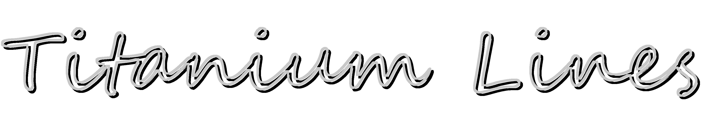
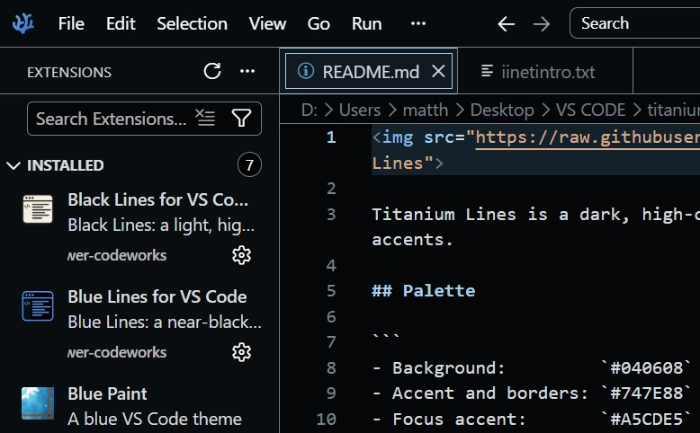
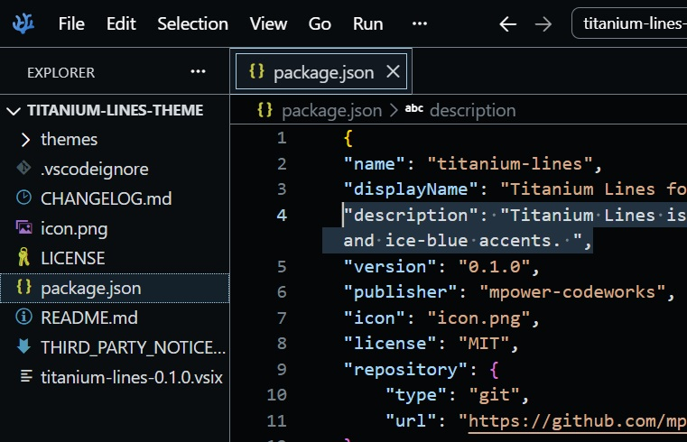
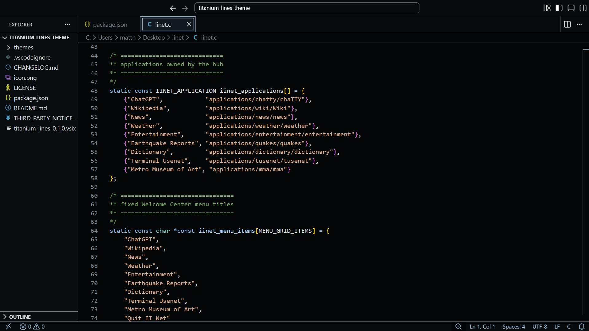
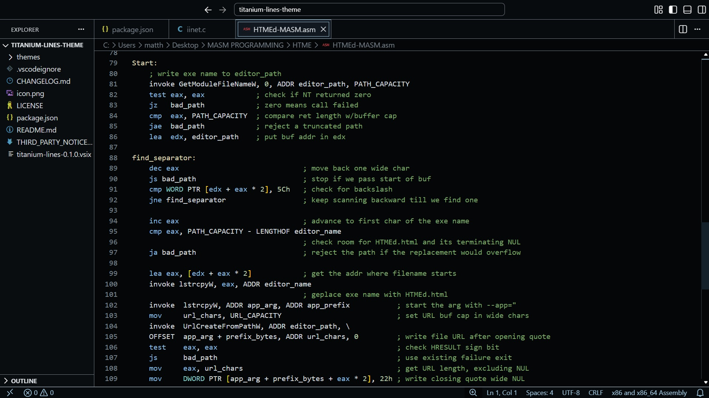

<!--
Titanium Lines is a dark, high-contrast VS Code color theme with 
cool metallic borders, subtle background depth, and ice-blue accents.
-->
𝖳𝗂𝗍𝖺𝗇𝗂𝗎𝗆 𝖫𝗂𝗇𝖾𝗌 𝗂𝗌 𝖺 𝖽𝖺𝗋𝗄, 𝗁𝗂𝗀𝗁-𝖼𝗈𝗇𝗍𝗋𝖺𝗌𝗍 𝖵𝖲 𝖢𝗈𝖽𝖾 𝖼𝗈𝗅𝗈𝗋 𝗍𝗁𝖾𝗆𝖾 𝗐𝗂𝗍𝗁 
𝖼𝗈𝗈𝗅 𝗆𝖾𝗍𝖺𝗅𝗅𝗂𝖼 𝖻𝗈𝗋𝖽𝖾𝗋𝗌, 𝗌𝗎𝖻𝗍𝗅𝖾 𝖻𝖺𝖼𝗄𝗀𝗋𝗈𝗎𝗇𝖽 𝖽𝖾𝗉𝗍𝗁, 𝖺𝗇𝖽 𝗂𝖼𝖾-𝖻𝗅𝗎𝖾 𝖺𝖼𝖼𝖾𝗇𝗍𝗌.

<!--
Its syntax colors are based on VS Code's built-in
**Default High Contrast** theme.
-->
𝖨𝗍𝗌 𝗌𝗒𝗇𝗍𝖺𝗑 𝖼𝗈𝗅𝗈𝗋𝗌 𝖺𝗋𝖾 𝖻𝖺𝗌𝖾𝖽 𝗈𝗇 𝖵𝖲 𝖢𝗈𝖽𝖾'𝗌 𝖻𝗎𝗂𝗅𝗍-𝗂𝗇
𝖣𝖾𝖿𝖺𝗎𝗅𝗍 𝖧𝗂𝗀𝗁 𝖢𝗈𝗇𝗍𝗋𝖺𝗌𝗍 𝗍𝗁𝖾𝗆𝖾.
<br><br>
𝖲𝖾𝖾 "𝖱𝖾𝗅𝖾𝖺𝗌𝖾𝗌" 𝗈𝗇 𝗍𝗁𝖾 𝗋𝗂𝗀𝗁𝗍 𝖿𝗈𝗋 𝗍𝗁𝖾 𝖻𝗂𝗇𝖺𝗋𝗒.
<br><br>

## 𝖯𝖺𝗅𝖾𝗍𝗍𝖾

```
- Background:         `#040608`
- Accent and borders: `#747E88`
- Focus accent:       `#A5CDE5`
- Interface text:     `#D4D9DD`
- Selection:          `#233241`
- Scrollbar:          `#14202A`
```

## 𝖲𝖼𝗋𝖾𝖾𝗇𝗌𝗁𝗈𝗍𝗌

<table>
    <tr>
        <td align="left" width="50%" valign="top">
            <br>
        </td>
        <td align="left" width="50%" valign="top">
            <br>
        </td>
    </tr>
    <tr>
        <td align="left" width="50%" valign="top">
            <br>
        </td>
        <td align="left" width="50%" valign="top">
            <br>
        </td>
    </tr>
</table>

Its syntax colors are based on VS Code's built-in **Default High Contrast** theme.

## 𝖠𝗍𝗍𝗋𝗂𝖻𝗎𝗍𝗂𝗈𝗇

The original syntax-color rules were taken from Microsoft's VS Code *Default High Contrast* theme `hc_black.json`, distributed under the MIT License. See `THIRD_PARTY_NOTICES.md`.

## ⓜⓟⓞⓦⓔⓡ-ⓒⓞⓓⓔⓦⓞⓡⓚⓢ
